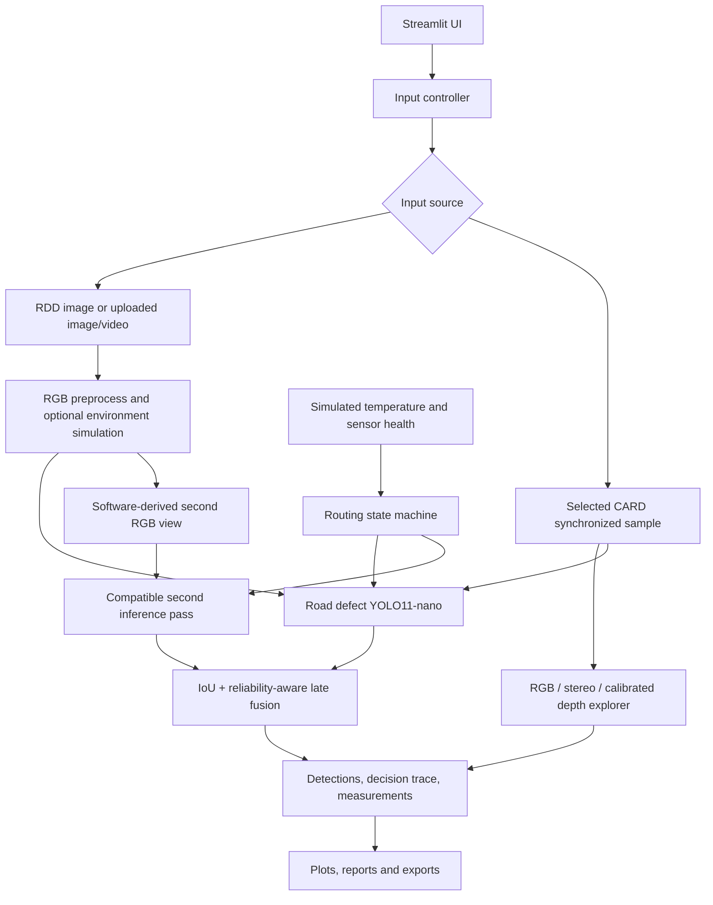

# RoadFusion AI — Academic Software Simulation Design

**Project title:** Software-Based Simulation of Adaptive Multimodal Sensor Fusion for Urban Road Infrastructure Diagnostics  
**Short name:** RoadFusion AI  
**Document type:** Implementation and demonstration design (`design.md`)  
**Status:** Proposed design; not evidence that code, training, or evaluation has completed  
**Target:** College project / reproducible local software demonstration  
**Primary repository:** https://github.com/aditya-a-git/ComputerVision  
**Implementation companion:** `ROADFUSION_CODING_AGENT_PROMPT.md` (staged execution instructions)  
**Research background:** `context.md` (original edge-deployment research context)

---

## 1. Executive design decision

We are **not building a physical edge-deployed road inspection device**. We are implementing a working **Python/Streamlit application** that demonstrates the central concepts of the research topic using public datasets, real computer-vision inference, software-generated environmental degradation, simple fusion algorithms, and a **virtual** edge-computing controller.

The final demo has three real software modules:

1. **Road defect detection:** train a YOLO11-nano detector using annotated RDD2022 road images; run real inference on images and short videos.
2. **Multimodal / multi-view diagnostics:** demonstrate a software-derived secondary RGB view and reliability-aware late fusion on RDD2022; separately explore **actual synchronized RGB/stereo/depth data** from CARD when access and sample files are available.
3. **Virtual adaptive edge device:** simulate device temperature and sensor failures, and **actually change which inference branches execute**; measure the resulting processing time on the local machine.

**Critical scientific boundary:** RDD2022 images are RGB; an RGB-derived false-color heatmap is **not** infrared, and a depth-looking visualization is **not** LiDAR. Our default RDD fusion experiment is a **two-view RGB ensemble**, not an experimentally validated RGB–thermal system. CARD provides a route to *real* multimodal RGB + stereo/depth data, not real thermal data. A sensor simulation must never be presented as a physical sensor measurement.

The project must remain runnable even if the user has not yet downloaded road images, trained a model, or obtained gated CARD access. Missing prerequisites are shown as missing, not substituted with invented results.

### 1.1 Goal and evaluation question

**Question:** Can a lightweight road-defect detector, software-based reliability-aware fusion, and adaptive runtime routing provide a useful demonstration of the robustness/compute trade-offs of multimodal edge perception without deploying on edge hardware?

We will answer through:

- qualitative detection overlays on actual road images/video;
- quantitative RDD2022 validation experiments on the **same labeled samples**;
- controlled, reproducible synthetic environmental perturbations;
- an explanation of the fusion decisions and failure fallbacks;
- measured local CPU/GPU latency and processed FPS under distinct runtime modes; and
- a separate CARD visualization showing synchronized real camera/depth observations **when legitimately available**.

The result is an **academic inspection aid prototype**, not a real-world road-safety, autonomous-driving, pavement-severity, or municipal-deployment product.

## 2. What is real, simulated, and optional?

| Component | Implementation | Truthful status |
|---|---|---|
| Road-camera input | Uploaded or dataset RGB images and short videos | Recorded/real RGB data |
| Road-damage annotations | Existing RDD2022 boxes | Ground-truth annotation metadata |
| Road-defect detector | RDD-trained Ultralytics YOLO11-nano | Actual ML inference **only when a valid trained checkpoint exists** |
| Night/fog/rain/noise/blur | OpenCV transformations | Simulated environmental conditions |
| Secondary RDD stream | Contrast/grayscale/equalized transformation of the **same RGB frame** | Software-derived RGB view, **not thermal** |
| Multi-view late fusion | IoU-based box matching and reliability-aware weighting | Actual algorithm, but views are not independent sensors |
| CARD stereo RGB/depth | Selected synchronized files from Hugging Face / official SDK | Real multimodal dataset observations, when obtained |
| Depth overlay | Projection using valid calibration + NPZ data | Derived visualization of real depth/3D measurements |
| Edge hardware temperature | Dashboard slider or deterministic temperature ramp | **Simulated** temperature |
| Adaptive execution | Change inference resolution, branch count, fallback | Real execution behavior triggered by simulated conditions |
| FPS/latency | Instrumented local inference and preprocessing | Real measurement **on the machine used**, not a Jetson benchmark |
| Jetson/Hailo/TensorRT/QAT/LiDAR hardware | Not implemented in the core project | Intentionally out of scope |

## 3. Scope and success criteria

### 3.1 Must build

- Streamlit app with distinct sections: **Home**, **Detect**, **Environment Lab**, **Fusion Lab**, **Virtual Edge Device**, **CARD Explorer**, **Experiments / Results**, **About / Limitations**.
- Data scripts that inspect, sample, validate, and prepare the **existing** `datasets/rdd2022.ndjson` using Hugging Face `datasets`.
- Small, reproducible RDD subset generation and correct YOLO-format export.
- Explicit image acquisition process with safe fallback when temporary image links expire or download fails.
- Train/evaluate commands and a Google Colab notebook for a 5-class YOLO11-nano detector.
- Upload-and-detect image workflow; bounded frame-by-frame video workflow.
- Environmental transformations that affect **model inputs**, not merely UI appearance.
- Reliability estimation, same-class bounding-box pairing, fusion/fallback, and stream failure simulations.
- Selected CARD sample discovery/download using `huggingface_hub`; real-data explorer that handles unavailable/gated data gracefully.
- Virtual temperature state machine and meaningful real runtime mode switching.
- Measured, provenance-tracked experiments, visualizations, exports, tests and instructions.
- Stage-by-stage commits directly to `main`, as specified by the coding-agent implementation prompt.

### 3.2 Explicitly avoid

- Real thermal camera, physical LiDAR, Jetson, Hailo, GPS, robotic vehicle, Raspberry Pi, field collection, or physical mounting.
- Full CARLA/ROS/Unreal/Unity vehicle simulation.
- React, FastAPI, cloud backend, microservices, external database or mandatory Docker setup.
- 3D BEV, custom complex attention architectures, MobileNetV4 surgery, TensorRT, custom CUDA, INT8 QAT and other deployment-heavy research extensions.
- Full 12.8 GB RDD image acquisition or entire CARD dataset by default.
- Automatic training, network downloads or credential prompts when Streamlit starts.
- Fabricated result tables, simulated FPS reported as measured FPS, and the claim that a false-color image proves thermal imaging works.

## 4. Dataset design

### 4.1 RDD2022: primary training and quantitative evaluation

**Repository path:** `datasets/rdd2022.ndjson`. The NDJSON is metadata plus annotation/image-reference records, **not embedded image bytes**.

Observed by inspecting the uploaded file:

| Property | Observed value |
|---|---:|
| Image records | 38,383 |
| Train records | 30,707 |
| Validation records | 7,676 |
| Total bounding boxes | 61,075 |
| Images with no boxes listed | 12,658 |
| Classes with observed boxes | 5 |

The metadata lists seven classes, but only five occur in actual bounding boxes. We will keep the five observed classes and their explicit mapping:

| Original class ID | Label | New YOLO class ID |
|---|---|---:|
| 0 | alligator crack | 0 |
| 2 | longitudinal crack | 1 |
| 3 | other corruption | 2 |
| 4 | pothole | 3 |
| 6 | transverse crack | 4 |

Original IDs **1 (block crack)** and **5 (repair)** are defined in the metadata but have no box annotations in this export. Do not add them as trained classes without verified data.

The image records include `file`, `url`, `width`, `height`, `split`, and sometimes `annotations.boxes`; each box is normalized `[class_id, center_x, center_y, width, height]`. Some records omit `annotations`, so normalize that field to an empty list. Keep real negative examples (zero boxes).

**Important image availability constraint:** the current NDJSON includes signed CDN links whose observed `Expires=1796214600` corresponds to **2026-12-02 12:30:00 UTC**. These links must not be treated as durable or guaranteed accessible. The downloader must handle expired/inaccessible URLs and support a user-supplied image directory or a separately verified matching source. **Never pair arbitrary images with unrelated NDJSON boxes.**

#### RDD pipeline

```text
Repository datasets/rdd2022.ndjson
            │
            ▼
Streaming schema audit ───► file / split / class / box validation report
            │
            ▼
Normalize rows to uniform JSONL (metadata row separated)
            │
            ▼
HF datasets.load_dataset("json", train/validation JSONL)
            │
            ▼
Deterministic sample manifests (e.g. 2,000 train / 400 val)
            │
            ▼
Download selected matching images OR import verified local files
            │
            ▼
Validate images + generate YOLO labels + data.yaml
            │
            ▼
YOLO training / model evaluation / app inference
```

**Why normalize first?** The first NDJSON row is dataset metadata, whereas later rows have image fields. A uniform, split-specific JSONL schema avoids mixed-column assumptions in `datasets.load_dataset("json")`.

**Sample strategy:** begin with approximately **2,000 training** and **400 existing validation** image records (configurable). Use a fixed random seed, maintain class coverage, and include a meaningful proportion of genuine zero-box examples. Preserve the original split; never move a `val` sample into `train`. Do not claim this subset represents the whole dataset until checked.

**Download strategy:** explicit CLI only; `--dry-run`, file-count and download-size caps, timeouts, retries, resumability, image decoding checks, reports of skipped records, path safety, and no logging of signed URL secrets. Full downloads require deliberate user action.

**YOLO export:**

```text
data/processed/rdd/
  images/train/*.jpg
  images/val/*.jpg
  labels/train/*.txt
  labels/val/*.txt
  data.yaml
```

Each label line is `new_class_id center_x center_y width height`. A negative image gets an empty label file. The `data.yaml` class ordering must exactly match the mapping above.

### 4.2 CARD: real multimodal demonstration, not the default RDD training source

**Hugging Face collection:** https://huggingface.co/CARD-Data  
**Suggested initial repository:** `CARD-Data/CARD-Germany-Batch1`  
**Official SDK:** https://github.com/cariad-tech/CARD-SDK

CARD is **not a thermal dataset** in the workflow described here. The available modalities documented by its SDK include stereo RGB cameras, optional depth / aggregated depth points, annotation labels, camera calibration and trajectories. Batch access may require the user's Hugging Face account to accept the dataset conditions.

**Download only a coherent small sample**, not whole batches. Use:

- `huggingface_hub.HfApi.list_repo_files()` to inspect the actual repository contents;
- official SDK `splits/small_samples.txt` and reference loader where applicable;
- `hf_hub_download()` for explicitly selected files, or tightly bounded `snapshot_download(allow_patterns=...)` after inspecting paths;
- original timestamp pairing and calibration, never filename-order guessing.

A CARD sample is useful only when its available components are correctly associated:

```text
One selected sequence / sample
├── camera image (prefer cam_1 reference view)
├── optional paired stereo cam_0 image
├── corresponding annotation label, if present
├── corresponding agg_depth/cam_1 NPZ, if present
└── matching camera calibration and metadata
```

If actual `cam_1` 3D points (`pts_cam`) and compatible calibration are present, create an image-space depth overlay with metric units. Filter invalid, negative-depth and out-of-frame points. Respect distortion/undistortion conventions and missing values. Do **not** render a synthetic depth image as though it were recorded LiDAR.

Class labels from CARD must be inspected independently: they may differ from the five RDD labels. Do not compute pooled RDD+CARD detection metrics without an explicit supported label mapping and genuinely matched annotated samples.

**If CARD access is blocked:** the CARD Explorer still launches, shows installation/login/terms instructions, supports `--list-only` or `--dry-run`, and can run file-processing unit tests on clearly labeled artificial fixtures. No claim of successful CARD download or actual RGB-depth performance is permitted until real data is loaded.

### 4.3 Dataset provenance and privacy

- Preserve original repo inputs `context.md` and `datasets/rdd2022.ndjson`.
- Track dataset name, source URL, split, selection seed, file/annotation IDs, local checks and licensing conditions.
- Keep downloaded media, checkpoints, private tokens, large caches, runs and exports out of Git.
- Treat Germany/Italy CARD license terms separately and verify the precise terms for the files used.
- Display attribution and dataset limitations in the About page.

## 5. System architecture



**Key boundary:** The RDD two-view pipeline and CARD depth viewer are separate until we have verified paired labels and a justified cross-modal fusion experiment. The model must not pretend to have received a depth measurement while processing an RDD frame.

### 5.1 Processing contracts

Use consistent Python dataclasses/dicts for:

- `InputFrame`: frame ID, source, image, timestamp if available, original dimensions, synthetic-transform description.
- `StreamObservation`: modality/view name, availability flag, reliability score, optional calibration/depth.
- `Detection`: class ID/name, score, bounding box `xyxy` in original image pixels, source view, model version.
- `FusionResult`: matched detections, unmatched detections, fused boxes/scores, selected weights, explanation and fallback reason.
- `RuntimeState`: **simulated** temperature, sensor health, chosen mode, resolution, active pipelines, transition reason.
- `ExperimentRecord`: dataset/split, sample IDs, seed, condition, model hash, machine/device, timings, metrics, run timestamp.

Never silently mix normalized box values with pixels, RDD class IDs with CARD IDs, or fake proxy values with measured physical units.

## 6. Detector and inference design

### 6.1 YOLO baseline

- Use Ultralytics `YOLO("yolo11n.pt")` as **initial pretrained weights for fine-tuning**, not as an already trained road-defect detector.
- Train with the prepared 5-class RDD `data.yaml`; default image size 640, configurable batch size, epochs, seed, and CPU/GPU device.
- Training is performed by CLI or a Colab notebook, **never inside Streamlit startup**.
- Save trained model outside Git, with documented expected path `models/rdd_best.pt` or selected configurable path.
- Show **“road-damage model not trained / checkpoint missing”** and the exact preparation steps if no valid checkpoint is available. Do not label COCO model predictions as potholes or cracks.
- Support confidence threshold and class filtering; produce boxes, labels, counts, confidence and a preview image. Confidences are model outputs, not validated correctness probabilities.
- For video, use sequential bounded frame processing (e.g. first N frames / optional stride), annotate frames, report skipped frames and allow a reasonable user-facing stop. Do not promise live multi-camera inference.

### 6.2 Training / evaluation artifacts

Keep checkpoint and experiment metadata: dataset subset manifest, train/val splits, class mapping, training hyperparameters, seed, framework versions, training loss and validation metrics. Training smoke-test weights are **not** sufficient evidence of accurate detection. Report the actual RDD mAP/precision/recall only if computed against held-out labeled images.

## 7. Environment simulator (OpenCV)

The user uploads or selects **one actual RGB frame**, chooses a condition, and the app runs the detector on the resulting transformed frame.

| Condition | Software method | Interpretation |
|---|---|---|
| Normal | Original image | Reference RGB |
| Dark/night | Scale brightness, optionally add noise | Synthetic low-light RGB |
| Fog | Blend light veil / reduce contrast | Approximate fog, not physically calibrated scattering |
| Rain | Draw synthetic streaks and optional blur | Approximate visual rain |
| Sensor noise | Add bounded Gaussian/Poisson-like noise | Synthetic image noise |
| Vibration/blur | Gaussian or directional motion blur | Degraded sharpness |
| Mud/occlusion | Apply a bounded overlay/mask | Artificial camera obstruction |
| Sensor dropout | Mark stream unavailable | Simulated disconnected input |

Requirements:

- Fixed random seed creates the same output for the same settings.
- Transformations really alter detector input; do not only alter displayed thumbnails.
- Default transformations preserve geometry and box coordinates, so original validation boxes remain valid. Any geometric transformation must also transform annotation coordinates or be excluded from quantitative evaluation.
- Side-by-side images show original and degraded image, predictions and time measurements.
- Distinguish a visual corruption from an actual sensor failure; a failed stream should not secretly pass the original image to a detector.

## 8. Fusion design

### 8.1 What the RDD experiment actually does

The baseline is a single RDD-trained model receiving ordinary RGB. A **secondary software view** is derived from the same frame using validated contrast/grayscale processing. When suitable input compatibility is established, run an additional detection pass and combine its predictions. Present this as **multi-view RGB late fusion** or a **software sensor-fusion proxy**.

A false-color `COLORMAP_INFERNO` image may be shown **for illustration only**; it must never be named thermal-camera footage. Do not simply pass arbitrary false-color data through an RGB-trained detector and claim its output is equivalent to an infrared-trained model. If the secondary view is unsuitable for the baseline detector, either use a consistently trained secondary model or disable its detection path and explain the limitation.

### 8.2 Reliability estimates

Estimate per-view quality from brightness/exposure, contrast, blur/sharpness, valid image pixels, occlusion indicator and explicit availability. Normalize into documented relative weights `w_rgb` and `w_secondary`. Provide manual override sliders for educational visualization and display which weights are **heuristic** or user-adjusted.

Weights are **not sensor calibration probabilities**. A darker frame does not prove a pothole is absent or present, and a confidence score alone does not measure accuracy.

### 8.3 Matching and combining detections

1. Convert all boxes to a common original-image pixel coordinate system.
2. Match only boxes with the **same class** and IoU above a configurable threshold.
3. For a matched pair, compute an explainable weighted combination of coordinates and optionally confidence; maintain trace of source predictions.
4. Handle unmatched boxes with a documented keep/suppress policy and confidence threshold; do not automatically discard every single-view detection.
5. Apply appropriate final duplicate suppression, ensure boxes stay in image bounds, and show reason/weights in the UI.
6. When a stream fails, use a tested valid single view; if both are invalid, return **unavailable** rather than inventing detections.

Illustrative fusion score **for a matched pair only**:

\[
C_{f} = \frac{w_{r}C_{r} + w_{s}C_{s}}{w_{r}+w_{s}}
\]

This is an explanatory heuristic, not a calibrated confidence or guaranteed fusion improvement. Handle `w_r + w_s = 0` as a failed/unavailable condition, not division by zero.

### 8.4 CARD depth extension

The CARD Explorer shows actual stereo/depth observations. A simple optional **depth-consistency heuristic** may compare RGB defect boxes with depth variation in the same calibrated region when such data exists. Clearly distinguish “depth-supported candidate” from “ground-truth confirmed pothole.” Do not reuse RDD evaluation results as evidence of CARD depth-fusion effectiveness.

## 9. Virtual edge-computing controller

The app has a **virtual temperature slider**, a day/night setting for illustrative routing, and explicit stream health inputs. The slider is not the laptop GPU temperature.

### 9.1 States and example policy

| Virtual condition | Mode | Actual executed work |
|---|---|---|
| Under 70°C | `full_fusion` | Two validated view inference passes at 640px |
| 70–85°C | `reduced_compute` | Smaller input, e.g. 320px, and/or fewer passes |
| Over 85°C | `single_modality` | One best available, compatible view |
| Both streams unavailable | `unavailable` | Do not run inference; display reason |

Thresholds are **illustrative, configurable simulation parameters**, not real safe hardware limits. Prefer explicit sensor-quality measurements/availability over a blind “night means thermal” rule (there is no thermal sensor here).

Implement a small state machine with separate recovery thresholds and minimum dwell time to prevent rapid oscillation around 70/85°C. A deterministic ramp option can show state transitions during a presentation.

### 9.2 What must be measured, not simulated

Record actual local timings around preprocessing, each detector pass, fusion and total frame processing. For GPU inference, synchronize appropriately before/after timing. Calculate end-to-end median (p50), p95 and throughput from measured wall-clock frame processing. Show machine type (CPU/GPU), model version, resolution, frame/sample count and whether batching/parallelism was used.

**Do not** display a hard-coded “31 FPS” or “58 FPS” as measured project performance. If no trained model is available, demonstrate the routing policy only and mark performance as **not measured**.

## 10. Streamlit UX / demo screens

Build one lightweight Python application with sidebar navigation/tabs, reusable controls, an explanatory data-source indicator, and helpful missing-prerequisite states.

| Page | Main controls | Main output |
|---|---|---|
| **Home** | Dataset/model health, quick-start actions | Scope, architecture, status, real-vs-simulated legend |
| **Detect** | Upload image/short MP4; model path; confidence/classes | Real YOLO boxes, table, counts, per-frame output and export |
| **Environment Lab** | Condition, intensity, seed, reset | Original/degraded side by side and measured prediction comparison |
| **Fusion Lab** | RGB/secondary/fused, view quality, failure toggles, IoU | Dual-view predictions, final matches, decision trace |
| **Virtual Edge Device** | Simulated °C, ramp, modality health | Current route, executed branches, timings, switching history |
| **CARD Explorer** | Select locally available sample / inspect availability | Actual stereo images, labels, calibrated depth overlay if available |
| **Experiments / Results** | Dataset split, runs, conditions | Actual mAP/PR and latency charts, downloadable CSV/JSON |
| **About / Limits** | Documentation links | Methods, licenses, citations, validity limitations |

**UX states:** `Ready`, `Needs RDD images`, `Needs trained model`, `CARD terms/access needed`, `CARD sample not downloaded`, `No valid sensor/view`, `No experiment results yet`. Missing prerequisites are not treated as application crashes.

**UI performance:** cache model loading and read-only manifests, not changing detection results; cap upload size and frame count, allow a stop/limit, use local temp files with cleanup, avoid training/download on page load, and do not block on multi-gigabyte downloads.

### 10.1 Short demo storyline

1. Open Home and explain software-only nature and exact datasets.
2. Open Detect, upload a real road image, show real boxes for the five supported RDD classes.
3. Open Environment Lab, introduce nighttime/fog/rain and compare detection changes.
4. Open Fusion Lab, show the processed secondary view, matched detections and heuristic weights; toggle a stream failure and show fallback.
5. Open Virtual Edge Device, raise **simulated** temperature; show actual pipeline/resolution changes and measured local inference times.
6. Open CARD Explorer, show genuine stereo/depth data if downloaded, or the clearly documented gated-access state.
7. Open Results and discuss real evaluation metrics, trade-offs, and limitations.

Avoid using illustrative screenshots or unlabeled generated images as evidence of measured experimental performance.

## 11. Evaluation and experiment design

### 11.1 RDD accuracy experiments

Use a **fixed chosen portion of the original RDD validation split**, common sample IDs, identical labels and reproducible seeds. Compare:

- `B0`: normal RGB-only inference;
- `E1`: RGB-only under synthetic darkness;
- `E2`: RGB-only under synthetic fog;
- `E3`: RGB-only under synthetic rain/blur/noise;
- `V1`: validated secondary processed-RGB view (if compatible);
- `F1`: reliability-aware two-view RGB late fusion;
- `R1`: one-stream dropout/fallback.

Measure per-class precision, recall, F1, AP@0.5, mAP@0.5, mAP@0.5:0.95 when a correct evaluator and real predictions are available. Show false positives, missed detections and how performance changes under controlled conditions. Box-level AP requires matching predictions to ground-truth boxes with correct class/IoU/PR integration—not averaging confidence scores.

**Do not promise fusion improves accuracy.** It is a testable hypothesis, and duplicating a model with correlated RGB views may add latency without improving results.

### 11.2 Runtime experiments

Run on the **same laptop/Colab runtime**, record hardware/software settings, sample count and image sizes, and compare:

| Mode | Per-frame work | Measure |
|---|---|---|
| Full fusion | Two inference passes at baseline resolution | Actual end-to-end latency and FPS |
| Reduced compute | Reduced resolution / fewer passes | Actual end-to-end latency and FPS |
| Single view | One RGB or compatible secondary pass | Actual end-to-end latency and FPS |
| Unavailable | No valid inference path | Correct health/error output; no fabricated timing |

A measured local CPU FPS is **not** a Jetson FPS. Throughput and single-frame latency are distinct when using pipelines/batching; document how both are calculated.

### 11.3 CARD experiments and claims

CARD is initially a **real-data explorer**, not automatically a full accuracy benchmark. Report qualitative stereo/depth inspection and any justified depth-consistency examples separately. Only publish quantitative RGB+depth detection gains if a truly paired, class-aligned evaluation set and implemented method support the conclusion.

### 11.4 Recorded outputs

Each experiment creates files under ignored `runs/` or `results/` directories:

```text
runs/<run-id>/
  config.json
  manifest.json            # model, dataset split, seed, environment
  predictions.jsonl
  per_sample_metrics.csv
  summary_metrics.json
  timings.csv
  figures/*.png
```

If a metric cannot be computed, record `not_run`/`unavailable` with a reason rather than showing invented values. Exports must distinguish human-adjusted sliders from dataset-inferred reliability.

## 12. Implementation repository layout

Expected structure **after implementation** (not a claim about existing files):

```text
ComputerVision/
├── design.md                       # this academic software implementation design
├── context.md                      # original research context; preserve
├── datasets/
│   └── rdd2022.ndjson              # original provided metadata; preserve
├── README.md
├── requirements.txt
├── .gitignore
├── app.py
├── configs/
│   ├── app.yaml
│   └── experiments.yaml
├── core/
│   ├── data/
│   │   ├── rdd.py
│   │   └── card.py
│   ├── detector.py
│   ├── environment.py
│   ├── sensor_simulator.py
│   ├── reliability.py
│   ├── fusion.py
│   ├── thermal_controller.py
│   └── metrics.py
├── scripts/
│   ├── inspect_rdd.py
│   ├── prepare_rdd.py
│   ├── inspect_card.py
│   ├── download_card_sample.py
│   ├── train.py
│   └── evaluate.py
├── notebooks/
│   └── train_yolo.ipynb
├── docs/
│   ├── ACADEMIC_SCOPE.md
│   ├── IMPLEMENTATION_STATUS.md
│   ├── DATASET_PROVENANCE.md
│   ├── EXPERIMENTS.md
│   ├── RESULTS.md
│   └── DEMO_SCRIPT.md
├── tests/
│   ├── test_rdd.py
│   ├── test_environment.py
│   ├── test_fusion.py
│   ├── test_card.py
│   └── test_thermal_controller.py
├── data/processed/                  # ignored, local images and YOLO labels
├── models/                          # ignored, trained weights
└── runs/                            # ignored, experiment artifacts
```

Use Python **3.11** as a conservative base and keep dependencies lean: `streamlit`, `ultralytics`, `torch` (as installed for device), `opencv-python-headless` where appropriate, `numpy`, `Pillow`, `datasets`, `huggingface_hub`, `pandas`, `matplotlib`, `pytest`, and only any proven additional needs. Pin tested versions in a lock or constraints file when finalized. Install CARD-SDK separately/optionally for sample analysis if compatible; do not make its heavy extras mandatory for normal app startup.

## 13. Staged delivery and Git rules

The coding agent must implement **sequentially**, with tests, a status update and **one logical commit directly to `main`** per stage. It may not create feature branches or pull requests, force-push, or claim a successful push without verification.

| Stage | Deliverable / acceptance gate | Commit message |
|---|---|---|
| 0 | Repo audit, academic scope, skeleton app starts without data | `chore: initialize academic RoadFusion app` |
| 1 | RDD schema check, HF `datasets` loading, bounded image preparation, YOLO export | `feat(data): inspect and prepare RDD2022 with HF datasets` |
| 2 | YOLO train/eval CLI + Colab notebook + real detector/no-weights state | `feat(model): train and run YOLO11n road-damage detection` |
| 3 | Deterministic environment transforms + true input-pipeline comparison | `feat(sim): add environmental degradation experiments` |
| 4 | Two-view RGB fusion, reliability, matching and dropout with tests | `feat(fusion): add reliability-aware multi-view fusion and fallback` |
| 5 | CARD Hub inspection, bounded download, sample/calibration reader, explorer | `feat(card): add gated HF sample loader and real RGB-depth explorer` |
| 6 | Virtual temperature state machine + **actual** runtime mode changes + timing | `feat(edge-sim): implement adaptive virtual-device routing` |
| 7 | Integrated UI, bounded video workflow, exports, coherent errors | `feat(ui): integrate RoadFusion demonstration dashboard` |
| 8 | Measured experiments, charts, test suite, instructions and final demo script | `docs(test): finish reproducible demo and validation` |

**Stage gate:** after implementing each stage, run relevant tests and an app/CLI smoke test; update `docs/IMPLEMENTATION_STATUS.md`; inspect `git status`; ensure no images, weights, caches, tokens or secrets are staged; commit to `main`; push only if authorized and safe; record the resulting SHA and any blockers. Do not stop at planning or mark an unverified stage “done.”

### 13.1 Intended commands (final names must match working implemented CLI)

```bash
# Create environment and start the web UI (once implementation exists)
python -m venv .venv
# activate .venv for the current operating system
pip install -r requirements.txt
streamlit run app.py

# Explicit one-time data / training tasks (illustrative CLI interface)
python scripts/inspect_rdd.py --input datasets/rdd2022.ndjson
python scripts/prepare_rdd.py --train-count 2000 --val-count 400 --seed 42 --dry-run
python scripts/prepare_rdd.py --train-count 2000 --val-count 400 --seed 42
python scripts/train.py --data data/processed/rdd/data.yaml --model yolo11n.pt
python scripts/evaluate.py --model models/rdd_best.pt --split val
python scripts/inspect_card.py --list-only
python scripts/download_card_sample.py --dry-run
pytest -q
```

These commands represent the **desired interface**; they are not verified working commands until the agent implements and tests them. Data downloads and training may need a network connection, accepted CARD access, or a Colab GPU.

## 14. Tests and acceptance criteria

### 14.1 Automated tests

- **RDD ingestion:** meta row separation, actual image counts/splits, empty annotation rows, class remapping, normalized box validation, path traversal, download failures, deterministic subset selection, no train/val mixing.
- **Image transforms:** repeatability with fixed seed, unchanged dimensions for nongeometric effects, valid `uint8`/pixel range, actual changed detector input.
- **Detection:** missing-weight status, class names, box transforms, image and bounded-video outputs, fake/mock weights clearly distinct from trained inference.
- **Fusion:** IoU, same-class pairing, weight normalization, zero-weight case, conflicting predictions, unmatched boxes, image frame alignment, individual/both stream failures.
- **CARD:** timestamp matching, missing modalities, calibration projection using labeled synthetic *test fixtures*, invalid depth point filtering, no silent substitution, unavailable/gated states.
- **Adaptive routing:** thresholds, hysteresis, recovery, mode changes affecting real executed inference branches and resolution, no inference in unavailable state.
- **Results:** metrics use actual stored predictions and annotations, correct units, missing-results state, reproducible manifests, no network download during ordinary tests.
- **UI:** app imports/starts on CPU without weights, CARD access or external network. Each page degrades gracefully with instructions.

### 14.2 Final acceptance checklist

- [ ] `streamlit run app.py` starts locally without physical hardware.
- [ ] App truthfully states what data/models are or are not installed.
- [ ] Existing RDD NDJSON is parsed and passed through Hugging Face `datasets`.
- [ ] Selected RDD images are acquired or explicit missing-image status is shown.
- [ ] Five-class YOLO labels, class map and `data.yaml` are correct.
- [ ] A trained model can detect real road defects on image/video.
- [ ] No checkpoint means **no fake pothole predictions**.
- [ ] Rain/fog/night/blur are applied to inference input.
- [ ] Two-view RGB processing and IoU-aware fusion work when validated.
- [ ] Stream loss produces a real fallback or unavailable state.
- [ ] CARD integration uses Hugging Face Hub and official format/SDK where practical.
- [ ] CARD absence is reported clearly; real-depth claims require real depth files.
- [ ] Temperature and routing are labeled simulated; route changes actual execution.
- [ ] FPS and latency figures are measured on the actual machine, not invented.
- [ ] RDD metrics use genuine labeled validation samples; no fake accuracy claims.
- [ ] Exports, demo script, method limitations and tests are available.
- [ ] Each implementation stage is committed on `main` only, with verified state.

## 15. Risks, mitigations and fallback plan

| Risk | Practical mitigation |
|---|---|
| NDJSON CDN links expire or fail | Verify access early; use official/verified matching image source or user-supplied local image directory; do not relabel unrelated images |
| No GPU / long training | Use Colab for training, small subset first, CPU-capable local inference; never present COCO weights as road-damage weights |
| CARD gated or huge | First implement inspection and official small-sample discovery; cap file counts/bytes; allow graceful no-CARD state |
| Derived second RGB view gives weak results | Keep RGB baseline; show accurate ablation; label as same-sensor multi-view ensemble; do not claim thermal gains |
| CARD depth lacks aligned labels/calibration | Show only available genuine images/metadata and say precisely what is missing; do not fake depth or metrics |
| Sensor quality heuristic is simplistic | Expose formula and controls; compare against labeled outcomes; never describe weights as calibrated certainty |
| Virtual edge temperature is not real | Clearly label virtual sensor, show executable routing and actual local timings separately |
| Small sample gives misleading high scores | Hold splits fixed, include negatives, record confidence intervals or sample counts, acknowledge distribution/selection bias |
| College demo machine has no data/model | Application starts with Home, dataset summary, simulation controls and actionable setup; all real inference states show prerequisites |

## 16. Deliverables for college evaluation

**Functional deliverables:** working Streamlit application, modular Python source, dataset preparation scripts, training/evaluation scripts and Colab notebook, optional CARD sample loader, reproducible test suite, saved experimental metrics and charts, and documented demo procedure.

**Report/presentation materials:** research problem statement, motivation, architecture diagram, dataset description, YOLO baseline, transformations, fusion rule, adaptive routing state machine, experimental methodology, screenshots from actual software, evaluated results, failure cases, honest limitations and future work.

**Proposed future extensions (not core deliverables):** real RGB–thermal paired dataset, dedicated lightweight encoders / intermediate feature fusion, onboard temperature telemetry, edge hardware, calibrated RGB-depth severity estimation, deployment optimizations and route-based mapping. These belong in the **Future Scope** slide, not in the implemented-feature claims.

## 17. Document authority and implementation rules

When documents conflict:

1. Explicit current user request and repository safety constraints.
2. **This `design.md`** for academic architecture, scope, UI behavior and scientific validity.
3. `ROADFUSION_CODING_AGENT_PROMPT.md` for detailed staging, agent workflow and commit messages.
4. `context.md` as research background, not a mandate to build physical edge deployment.

**Definition of done:** A reviewer can start the app locally without special hardware, inspect the RDD metadata, follow exact steps to prepare a small valid dataset and train a real detector, reproduce environmental and fusion simulations, observe actual execution switching under a virtual temperature control, inspect genuine CARD data where available, and see only **measured and well-labeled** experimental results. No physical sensor or edge device is required.

---

**One-sentence presentation summary:** *RoadFusion AI uses real road-damage annotations and a lightweight vision model to demonstrate detection, software-based robustness/fusion experiments, and virtual adaptive edge inference, with optional genuine RGB-depth observations from CARD—all without specialized hardware.*
